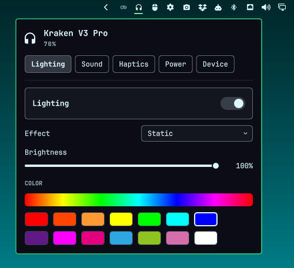

# OmaKraken

Razer Kraken V3 Pro controls for the [Omarchy](https://omarchy.org) bar:
battery, lighting and effects, sidetone, mic volume, haptics and power saving.
No Razer Synapse, no Windows, no browser. Every color and font follows your
Omarchy theme.



## What it does

A headset icon on the bar shows the battery on hover. Click it for a dropdown
with five tabs:

| Tab | Settings |
| --- | --- |
| Lighting | Lighting on or off, effect (Static, Breathing, Spectrum Cycling), brightness, speed, color |
| Sound | Sidetone on or off and its level (1-5), mic volume |
| Haptics | HyperSense haptics on or off, Low / Medium / High |
| Power | Power saving on or off, and after how many minutes (15-60) |
| Device | Battery, serial number, dongle |

You get a notification when the battery drops to 20% and again at 10%.

The headset has no lighting effects of its own; Razer's app streams the
colors. OmaKraken does the same, so effects run while the Omarchy shell is
running. When nothing drives the lights, the headset falls back to its own
slow color cycle. The lights stay off while the headset charges.

Equalizer, bass boost, sound normalization, voice clarity and THX Spatial
Audio are effects inside Razer's Windows app. The headset has no setting for
them, so they are not here.

## Supported headsets

The Razer Kraken V3 Pro with its wireless dongle (USB `1532:052c`). Check with:

```bash
lsusb | grep 1532:052c
```

## Install

You need Omarchy 4, the Kraken V3 Pro's dongle plugged in, and Python 3
(Omarchy already has it).

**1. Add the plugin.**

```bash
omarchy plugin add https://github.com/Dankestrick/OmaKraken.git --enable
```

That clones into `~/.config/omarchy/plugins/io.github.dankestrick.omakraken/`
and places the icon on the **right** of the bar. To move it:

```bash
omarchy bar move io.github.dankestrick.omakraken --section right
```

**2. Let your session talk to the dongle (one time, needs root).** The
dongle's settings channel is a serial port that only root and the `uucp`
group can open until a udev rule allows it. The rule ships with the plugin in
[`udev/70-razer-kraken.rules`](udev/70-razer-kraken.rules), so you can read it
first. Copy it into place and reload udev:

```bash
sudo install -m 0644 ~/.config/omarchy/plugins/io.github.dankestrick.omakraken/udev/70-razer-kraken.rules /etc/udev/rules.d/
sudo udevadm control --reload-rules && sudo udevadm trigger
```

Then unplug the dongle and plug it back in. This is the only step that needs
root. See [Permissions and safety](#permissions-and-safety) for exactly what it
allows.

Do not symlink a git checkout into the plugins folder. Omarchy rejects a
plugin tree that is a symlink.

## Permissions and safety

OmaKraken runs as a normal Omarchy plugin, with your user's permissions.

- **One root step, at install.** Step 2 copies one udev rule into
  `/etc/udev/rules.d/`. After that, nothing needs root. At runtime,
  OmaKraken does not use sudo or pkexec. It installs no services.
- **What the rule allows.** It matches only the Kraken dongle's serial port
  (USB `1532:052c`) and tags it `uaccess`, which gives the user at the active
  local session read and write access, the same way Linux handles game
  controllers. No other device is affected, and the port is not opened to
  other users. It also tells ModemManager not to probe the port as a modem.
- **What it talks to.** Only the dongle's settings channel. Mic volume goes
  through PipeWire like any other microphone. It makes no network connections.
- **What it runs.** Its own helper (`helpers/omakrakenctl`, plain Python) for
  as long as the plugin is loaded, and `notify-send` for battery alerts. The
  helper stops when the plugin is disabled or the shell exits. Only one helper
  can use the headset at a time (a lock file in
  `$XDG_RUNTIME_DIR/omakraken/`).
- **What it writes.** Settings go to the headset. On disk it writes only
  `~/.config/omakraken/settings.json` (the lighting and haptics settings,
  because the headset cannot report those back), private to you: the file is
  0600 and its folder 0700. A settings file that cannot be read is never
  overwritten.
- **Nothing can hang the shell.** Every command to the dongle has a deadline,
  and the port is flushed before it is closed.

## Use

| Action | What happens |
| --- | --- |
| Hover the bar icon | Battery |
| Left-click the bar icon | Open or close the dropdown |
| Right-click the bar icon | Read the headset again |
| `←` / `→` in the dropdown | Switch tabs |
| `Esc` | Close the dropdown |

Sidetone and power saving are read back from the headset after each change,
so what you see is what the headset has.

## Troubleshooting

| Problem | Fix |
| --- | --- |
| "Dongle not found" | Plug the dongle in. Check that `lsusb` lists `1532:052c`. |
| "No permission to open /dev/ttyACM…" | Do install step 2, then unplug and replug the dongle. |
| "The headset is not answering" | Turn the headset on. If it stays like this, unplug and replug the dongle. Plugging or unplugging the charger can stop the dongle's settings channel until it is replugged. Sound keeps working. |
| Lights are off | The headset keeps its lights off while charging. |

The helper also works from a terminal while the plugin is disabled, which
helps when reporting a problem:

```bash
python3 ~/.config/omarchy/plugins/io.github.dankestrick.omakraken/helpers/omakrakenctl status
```

## Remove

```bash
omarchy plugin remove io.github.dankestrick.omakraken --yes
```

That removes the plugin files and the bar icon. Omarchy keeps a backup copy
named `~/.config/omarchy/plugins/.io.github.dankestrick.omakraken.bak.<date>`,
which you can delete. It leaves the udev rule and your saved settings. To
remove the settings too:

```bash
rm -rf ~/.config/omakraken
```

Removing the udev rule needs root, like installing it:

```bash
sudo rm -f /etc/udev/rules.d/70-razer-kraken.rules
sudo udevadm control --reload-rules && sudo udevadm trigger
```

The headset keeps its sidetone and power saving settings; they are stored on
the headset.

## Credits

- The lighting commands were first found by paladin-devops for
  [openrazer PR #2884](https://github.com/openrazer/openrazer/pull/2884).
- Everything else was worked out by capturing Razer Synapse's traffic to the
  headset in a Windows virtual machine.

OmaKraken is not made by or affiliated with Razer.

## License

[MIT](LICENSE)
